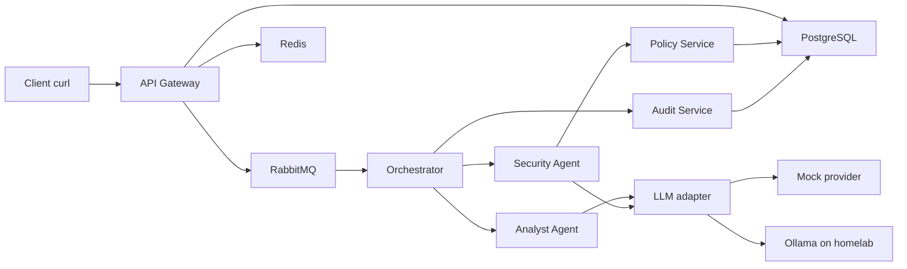

# Архитектура

Целевая логическая схема. На ранних этапах несколько ролей могут временно жить в одном контейнере, если это ускоряет запуск. Имена компонентов и будущие сетевые границы фиксируются заранее, чтобы их не переписывать при разделении.

## Компоненты

| Компонент | Ответственность | Взаимодействие |
| --- | --- | --- |
| API Gateway (FastAPI) | Принимает запросы, создаёт задачи, отдаёт статус и результат | HTTP, PostgreSQL, RabbitMQ, Redis |
| Orchestrator | Выбирает агентов и ведёт последовательность | RabbitMQ, воркеры агентов, Policy |
| Analyst Agent | Выделяет факты и контекст события | LLM adapter, RabbitMQ |
| Security Agent | Оценивает риск и предлагает действие | LLM adapter, Policy |
| Policy Service | Проверяет действие по правилам и уровню риска | API или библиотечный вызов, PostgreSQL |
| Audit Service | Пишет журнал решений и попыток | RabbitMQ, PostgreSQL |
| PostgreSQL | Задачи, результаты, политики, аудит; позже standby | Внутренняя сеть данных |
| Redis | Кэш статуса и результата с TTL | Внутренняя сеть кэша |
| RabbitMQ | Очереди задач, результатов и аудита; позже учебный кластер | Внутренняя сеть брокера |
| LLM adapter | Единый вызов модели | `mock` локально или `ollama` на homelab |

## Поток одной задачи

1. Клиент отправляет `POST /tasks` с типом события и исходными данными.
2. API проверяет запрос, пишет задачу в PostgreSQL и публикует сообщение в RabbitMQ.
3. Orchestrator забирает сообщение и запускает workflow.
4. Analyst Agent возвращает структурированный разбор.
5. Security Agent возвращает оценку риска и предложенное действие. Это предложение, а не выполненная команда.
6. Policy Service отвечает `ALLOW`, `DENY` или `REQUIRE_APPROVAL`.
7. Разрешённое действие в учебном MVP только симулируется. `REQUIRE_APPROVAL` останавливает выполнение до отдельного подтверждения. Неизвестное действие получает `DENY`.
8. Результат и статус пишутся в PostgreSQL. Статус может лежать в Redis. Событие уходит в Audit Service.
9. Клиент с `task_id` опрашивает `GET /tasks/{task_id}`.

## Политика действий

Агент отдаёт структуру с именем действия, параметрами и уровнем риска. Policy сверяет allowlist, параметры и контекст.

- `ALLOW` — безопасное действие из списка, параметры в допустимых границах. Исполнение в MVP симулируется.
- `DENY` — действие вне списка, с недопустимыми параметрами или с неприемлемым риском.
- `REQUIRE_APPROVAL` — чувствительное действие. До подтверждения исполнитель не запускается.

Каждое решение и каждая попытка попадают в аудит.

## Компонент и требование курса

| Компонент | Этап курса | Что им закрывается |
| --- | --- | --- |
| API, Orchestrator, Agent | 2 | Отдельные HTTP-сервисы, hello-world, health, Compose |
| PostgreSQL | 3 и 5 | CRUD и SQL-схема; primary/standby, backup и restore |
| Redis | 3 | Чтение, запись, cache-aside, TTL, инвалидация |
| RabbitMQ | 3 и 5 | Publish, consume, ack; отказ узла и quorum queues |
| Сети и firewall | 4 | Сегменты, allow, deny, отказ легитимного правила |
| Policy, Audit, два агента, LLM adapter | После базы | Сквозной сценарий SentinelAI, три решения политики |
| Показатели обслуживания | 5 | Учебные целевые SLO, RPO, RTO, MTTR, MTBF |

Инфраструктурные тесты этапов 2–5 вызывают заглушку агента или mock-провайдер. Доступность homelab на эти этапы не влияет.
