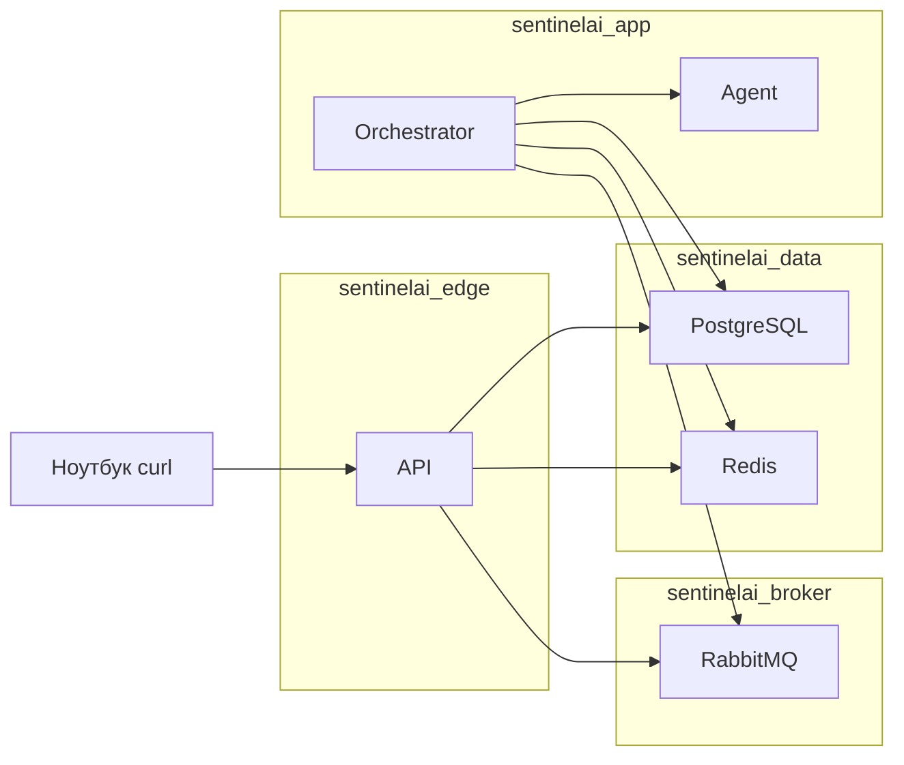

# Сети и firewall

Четыре сети Docker разделяют контейнеры. Фильтр этапа 4 — отдельная цепочка `SENTINEL-FW` в `DOCKER-USER` хоста. Сама сеть Docker firewall не заменяет: правило можно снять и увидеть, что рабочий поток ломается.



Мосты на хосте называются `sntl_edge`, `sntl_app`, `sntl_data` и `sntl_broker`. Имя моста короче имени сети: у интерфейса Linux предел 15 символов.

## Кто в какой сети

| Сеть | Контейнеры |
| --- | --- |
| `sentinelai_edge` | API |
| `sentinelai_app` | API, Orchestrator, Agent |
| `sentinelai_data` | API, Orchestrator, PostgreSQL, Redis |
| `sentinelai_broker` | API, Orchestrator, RabbitMQ |

Agent не подключён к сети данных и к сети брокера. Имя `postgres` из него не резолвится.

С ноутбука по-прежнему открыты только локальные порты: API `127.0.0.1:8000`, Orchestrator `8001`, Agent `8002`, панель RabbitMQ `15672`. PostgreSQL и Redis наружу не опубликованы.

## Правила

Скрипт читает текущие IP контейнеров и пересобирает цепочку. После `docker compose up` адреса меняются, поэтому правила применяют заново.

Разрешено новое TCP-соединение:

| Источник | Назначение | Порт | Зачем |
| --- | --- | --- | --- |
| API в сети брокера | RabbitMQ | 5672 | публикация задачи |
| Orchestrator в сети брокера | RabbitMQ | 5672 | потребление задачи |
| API в сети данных | PostgreSQL | 5432 | CRUD |
| Orchestrator в сети данных | PostgreSQL | 5432 | результат агента |
| API в сети данных | Redis | 6379 | кэш статуса |
| Orchestrator в сети данных | Redis | 6379 | сброс кэша |
| Orchestrator в сети приложения | Agent | 8000 | вызов заглушки |

Дальше цепочка отбрасывает любое другое новое соединение к PostgreSQL:5432, Redis:6379 и RabbitMQ:5672. Уже установленные соединения возвращаются в `DOCKER-USER` без изменений. Весь остальной трафик тоже возвращается туда же.

Из-за этого правила хоста, которые уже были в `DOCKER-USER`, не удаляются. Цепочка не стоит в `INPUT`, поэтому SSH ноутбука не затрагивается. Исходящий маршрут ноутбука к homelab тоже не затрагивается: это не forwarded-трафик контейнеров.

Ограничения:

- Правила живут до перезагрузки или перезапуска Docker. Их нужно применить снова командой `apply`.
- Скрипт меняет netfilter через служебный контейнер `sentinelai-firewall` с `CAP_NET_ADMIN` и сетью хоста. Так правило попадает в `DOCKER-USER` без интерактивного `sudo`.
- Временно закрытый путь Orchestrator → RabbitMQ снимается командой `unbreak`. Полный откат — `rollback`.

## Команды

```bash
docker compose up -d
./scripts/firewall.sh apply
./scripts/firewall.sh status
./scripts/firewall.sh test
./scripts/firewall.sh rollback
```

`test` применяет правила, проверяет три сценария и снимает временную блокировку, даже если проверка оборвётся. Постоянные allow/deny после теста остаются. `rollback` убирает только `SENTINEL-FW`.

## Проверено на ноутбуке

1. Разрешённый поток. `orchestrator -> rabbitmq:5672` ответил `open`.
2. Запрещённый поток. Agent получил `gaierror` на имя `postgres`. Контейнер, посаженный в `sentinelai_data` и не входящий в allowlist, при соединении с PostgreSQL:5432 получил `TimeoutError`. Счётчик DROP на этот порт вырос с 0 до 3.
3. Блокировка легитимного правила. На время DROP для Orchestrator → RabbitMQ:5672 новое соединение дало `TimeoutError`, а новая задача осталась `pending`. После `unbreak` соединение снова `open`, следующая задача дошла до `done`. API `127.0.0.1:8000` и Agent `127.0.0.1:8002` при этом отвечали.
